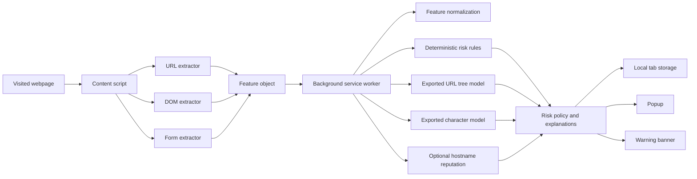
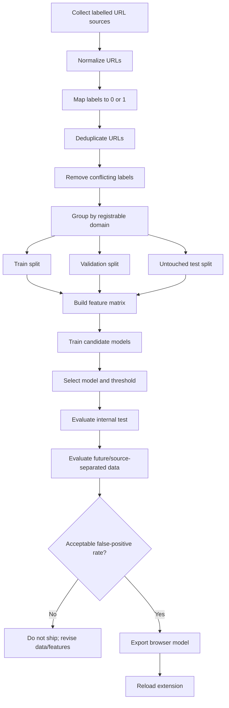
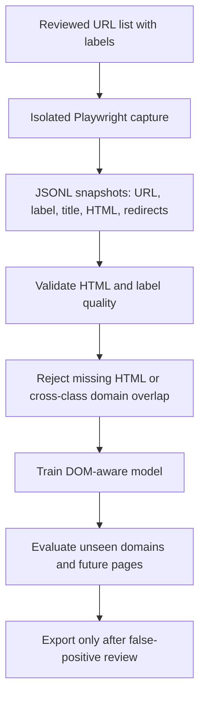
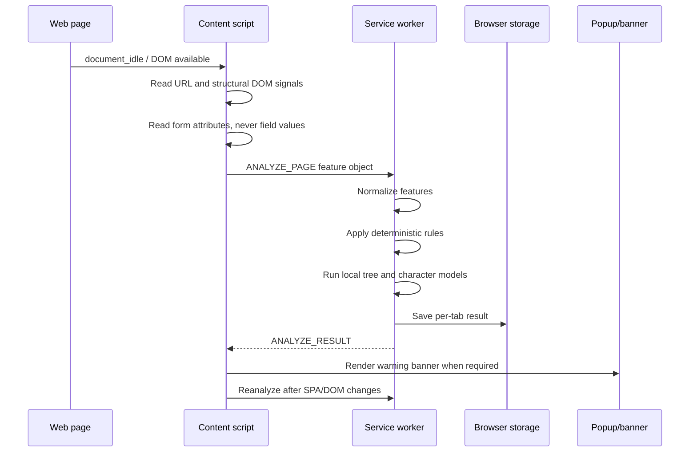

# PhishGuard: complete project architecture

PhishGuard is a privacy-first browser extension for identifying phishing
indicators in a visited webpage. It combines URL analysis, page/DOM analysis,
form analysis, deterministic rules, and exported on-device machine-learning
models.

This document explains the project from data collection through model training,
browser inference, warning display, and evaluation.

> **Important scope statement:** PhishGuard is a research prototype and warning
> system. It is not a replacement for browser Safe Browsing, endpoint security,
> or a verified threat-intelligence service. A score is evidence-based risk, not
> a proof that a site is malicious.

## 1. Project objective

The project tries to answer:

> Does the current URL and page contain enough observable evidence to warn the
> user that it may be attempting phishing or credential theft?

The extension deliberately avoids reading:

- Password values
- Text typed into fields
- Cookies
- Browser history
- Authentication tokens

It reads structural information such as the URL, form attributes, element
types, script metadata, and limited visible text used for generic brand
indicators.

## 2. High-level architecture



### Main components

| Component | Technology | Responsibility |
|---|---|---|
| Content script | JavaScript WebExtension API | Runs in the page and collects URL, DOM, and form structure |
| URL extractor | JavaScript | Measures URL and hostname indicators |
| DOM extractor | JavaScript | Measures page title, scripts, iframes, meta refreshes, and front-page signals |
| Form extractor | JavaScript | Measures credential fields and form destinations without reading values |
| Service worker | JavaScript, Manifest V3 | Combines rules and local model predictions |
| Risk scorer | JavaScript | Normalizes features and computes the deterministic score |
| URL ML model | Python/scikit-learn, exported JavaScript | Classifies the feature vector locally |
| Character model | Python/scikit-learn, exported JavaScript | Provides a secondary URL character-pattern signal |
| Popup/options | HTML, CSS, JavaScript | Displays results and manages optional settings |
| Training pipeline | Python, NumPy, pandas-like CSV processing, scikit-learn, joblib | Loads data, builds features, trains, evaluates, and exports models |
| Tests | Node.js, jsdom | Tests browser feature extraction and scoring |

## 3. End-to-end workflow



The DOM-model workflow is separate:



## 4. Datasets used

The repository contains multiple dataset types. They should not be treated as
equivalent.

### 4.1 Historical malicious URL dataset

File:

```text
ml/data/malicious_urls.csv
```

Source configured in [train_model.py](../ml/src/train_model.py):

```text
Using-machine-learning-to-detect-malicious-URLs
```

This source contains URL labels such as `good` and `bad`. It is useful for
baseline URL experiments, but it is historical and may not represent current
phishing campaigns.

### 4.2 EdgePhish dataset

File:

```text
ml/data/edgephish_balanced_urls.csv
```

This is an additional labelled URL corpus. It is included with
`--include-edgephish` and is used to increase URL-pattern diversity.

### 4.3 Current phishing feeds

Files:

```text
ml/data/recent_phishing_feeds.csv
ml/data/phishtank_recent.csv
```

These provide current or recent phishing observations. They are especially
useful for future/source-separated evaluation. They should not be added to
training before being used as an untouched test set.

### 4.4 Current legitimate feed

File:

```text
ml/data/recent_legitimate_feed.csv
```

This is derived from a legitimate popularity feed. It supplies realistic
legitimate URLs, including long URLs, login pages, redirects, business sites,
CDN paths, and shared hosting.

This dataset is essential because a phishing detector can look accurate on
phishing examples while still warning on too many normal sites.

### 4.5 DOM snapshot dataset

The DOM dataset is not the same as a URL feed. It must contain reviewed,
captured HTML pages with:

```text
url
label
title
html
final_url
redirect_count
source
observed_at
```

The validator in [dom_dataset.py](../ml/src/dom_dataset.py) rejects:

- Missing HTML
- Invalid labels
- Oversized snapshots
- Cross-class registrable-domain overlap
- Datasets containing only one class

URL-only rows must not be given empty HTML and then described as DOM training
examples.

## 5. Label definitions

The training loader maps labels to two classes:

| Numeric label | Meaning | Accepted examples |
|---:|---|---|
| `0` | Legitimate/benign | `good`, `benign`, `legitimate`, `safe` |
| `1` | Suspicious/malicious | `bad`, `phishing`, `malware`, `defacement`, `malicious` |

The current binary label is broader than phishing alone. A `1` may represent
malware or defacement as well as credential phishing. For a production-quality
research study, these should eventually be separated into distinct classes:

```text
legitimate
credential_phishing
malware
defacement
scam
uncertain
```

Conflicting labels for the same normalized URL are removed rather than guessed.

## 6. URL normalization and dataset preparation

The training loader performs these steps:

1. Trim whitespace.
2. Add `https://` when a dataset omits a scheme.
3. Read the `url` and `type` or `label` columns.
4. Ignore rows with unknown labels.
5. Deduplicate by normalized URL.
6. Remove URLs with conflicting labels.
7. Optionally sample a balanced set.
8. Split by registrable domain.

The `--balanced` option is useful for controlled experiments, but it does not
represent real browsing prevalence. Real browsing contains far more legitimate
pages than phishing pages. Therefore, future evaluation must preserve all
phishing rows and use a realistic legitimate population.

## 7. What the features mean

The shared feature contract is defined in:

- Python: [feature_engineering.py](../ml/src/feature_engineering.py)
- Browser: [feature-schema.js](../extension/src/shared/feature-schema.js)

### 7.1 URL and hostname features

| Feature | What it measures | Why it can help | Limitation |
|---|---|---|---|
| `url_length` | Full URL length | Phishing URLs may contain long paths or parameters | Legitimate tracking and application URLs can also be long |
| `hostname_length` | Hostname length | Random or impersonating hosts may be long | Large legitimate organizations may use long hosts |
| `subdomain_count` | Number of hostname labels beyond the registrable domain | Deep nested hosts can hide the real owner | CDNs and enterprise systems commonly use subdomains |
| `dot_count` | Dots in hostname and URL | Complex URLs may be suspicious | Many normal URLs contain dots in paths and query data |
| `digit_count` | Digits in hostname and path | Random campaign IDs or IP-like names may contain digits | Product IDs and normal URLs also contain digits |
| `suspicious_char_count` | `@`, `%`, and repeated dashes | Can indicate obfuscation or confusing URL boundaries | Encoding and normal hyphenated names are common |
| `has_ip_address` | Hostname is an IP address | Credential pages on raw IPs are high risk | Development and internal sites may use IPs |
| `uses_http` | Page uses HTTP rather than HTTPS | Credential pages without transport encryption are risky | HTTP is not proof of phishing and localhost is treated specially |
| `has_punycode` | Punycode/Unicode lookalike indicator | Can indicate IDN homograph attacks | Legitimate internationalized domains also use IDNs |
| `hostname_entropy` | Approximate character randomness | Random campaign hosts may have high entropy | Some legitimate generated hostnames are random |
| `has_unusual_port` | Non-standard port | Phishing pages sometimes run on unusual ports | Developers and enterprise applications may use custom ports |

### 7.2 Text and brand features

| Feature | Meaning |
|---|---|
| `suspicious_keyword_count` | Count of terms such as login, verify, secure, account, update, wallet, bank, signin, payment, and confirm found in the URL/host |
| `brand_domain_mismatch` | A supported brand is claimed but the host is not an official brand domain |
| `page_title_mismatch` | The hostname and page title appear inconsistent |
| `brand_name_in_title` | A supported brand appears in the title |
| `brand_name_in_visible_text` | A supported brand appears in visible page text |
| `brand_name_in_url` | A supported brand appears in the URL |

A brand name alone is not a phishing verdict. Official domains such as
Amazon Business are allowed unless stronger page evidence is present.

### 7.3 Form and DOM features

| Feature | Meaning |
|---|---|
| `form_count` | Number of HTML forms |
| `has_password_input` | Password or password-like input exists |
| `credential_field_count` | Count of password, email, OTP, card, CVV, wallet, PAN, or Aadhaar-like fields |
| `cross_domain_form_action` | A form submits to another host or untrusted destination |
| `hidden_field_count` | Number of hidden inputs |
| `form_action_is_empty` | A form has an empty or malformed action |
| `obfuscated_script_score` | Script contains patterns such as `eval`, `atob`, `fromCharCode`, or encoded content |
| `hidden_iframe_count` | Hidden or zero-size iframes |
| `external_script_count` | Scripts loaded from another host |
| `meta_refresh_count` | Timed HTML redirects |
| `credential_submission_script` | Credential-like inputs coexist with script patterns associated with input observation or submission |

These features are strongest when used in combinations. A legitimate login form
alone is normal; a credential form plus an untrusted cross-domain destination
and obfuscated script is much more concerning.

### 7.4 Optional or currently limited features

`domain_registration_age_days` is part of the contract but is currently `0`
when no lookup is configured. It should not be described as an active signal
until a privacy-preserving lookup is implemented and evaluated.

## 8. How a page is classified

PhishGuard does not use one rule such as “long URL means phishing.” It combines
several evidence sources.

### 8.1 Deterministic score

The browser normalizes features into approximately `[0, 1]`, applies configured
weights, and calculates:

```text
raw_score = sum(weight_i * normalized_feature_i)
score = round(100 * raw_score / sum(weights))
```

The score is clamped to `0–100`.

Risk bands are:

| Score | Label | User action |
|---:|---|---|
| `0–34` | Legitimate/no strong indicators | No warning |
| `35–64` | Suspicious | Caution |
| `65–100` | Likely phishing | Warning |

The score is evidence strength, not a calibrated probability.

### 8.2 Explicit high-confidence rules

The service worker adds extra risk for strong indicators such as:

- IP-address host
- Brand-domain mismatch
- Multiple redirects
- Suspicious shared hosting combined with a brand claim
- Multiple suspicious front-page signals

Official brand domains are capped at low risk unless strong page-level evidence
appears. This prevents ordinary Amazon, PayPal, or Microsoft pages from being
warned merely because they contain a brand name or login form.

### 8.3 URL tree model

The Python trainer compares:

- Logistic regression
- Random Forest candidates
- Extra Trees candidates

The currently exported browser-compatible model is a Random Forest-style tree
ensemble. Each tree is serialized into JavaScript. The browser walks each tree
using the feature vector and averages the leaf phishing probabilities.

The `.joblib` file is used for Python training/evaluation. The extension uses
the generated JavaScript file:

```text
extension/src/shared/trained-model-data.js
```

### 8.4 Character n-gram model

The character model uses URL character n-grams, typically 3–5 character
sequences, with TF-IDF and logistic regression. It is a secondary signal and is
used only at a high-confidence threshold because lower thresholds generated too
many legitimate-site false positives.

### 8.5 Front-page analysis

Landing paths such as `/`, `/home`, `/index`, and `/welcome` receive a
conservative page-level check. It counts combinations of:

- Credential fields
- Hidden iframes
- Timed redirects
- Obfuscated scripts
- Brand claims combined with credential collection

Normal homepage text, external assets, or a standard login page alone do not
create a strong front-page warning.

## 9. Browser runtime data flow



### Runtime inputs

The analysis input is a feature object containing:

```text
url
hostname and URL measurements
title and generic brand indicators
form counts and form destinations
credential-field presence, not values
script/iframe/meta-refresh metadata
front-page indicators
optional redirect/reputation metadata
```

### Runtime protections

- Analysis runs locally by default.
- Password values are not read.
- Form values are not read.
- Content is not uploaded by default.
- The content script rescans after SPA route changes.
- The content script rescans when credential-related elements are inserted.
- Warnings are removed if a later scan no longer supports them.

## 10. Model evaluation and result matrix

### Internal held-out benchmark

The project has an internal grouped benchmark for the historical/multidataset
training run. The documented result was approximately:

| Metric | Result |
|---|---:|
| Accuracy | 87.39% |
| Precision | 89.82% |
| Recall | 84.34% |
| F1 | 86.99% |
| ROC-AUC | 0.9451 |

These results are not production performance because training and test data
come from related historical sources.

### Future/source-separated evaluation

The future protocol evaluates current phishing feeds against a separate current
legitimate feed and removes cross-class registrable-domain overlap.

The recorded v0.4 future evaluation showed approximately:

| Metric | Result |
|---|---:|
| Accuracy | 50.85% |
| Precision | 46.99% |
| Recall | 44.30% |
| F1 | 45.60% |
| ROC-AUC | 0.505 |
| False-positive rate | 43.45% |
| False-negative rate | 55.70% |

The feed-trained v0.5 experiment improved phishing recall but produced an
approximately 82.63% false-positive rate in the evaluated future set. It should
not be shipped as a general warning model without recalibration and better
legitimate data.

### Interpretation

The difference between internal and future results demonstrates dataset shift:

- Phishing campaigns change over time.
- URL formats and hosting providers change.
- Historical datasets contain source-specific artifacts.
- URL-only data does not represent page content.
- Balanced training data does not represent normal browsing prevalence.

The correct success criterion is not the highest historical accuracy. It is an
acceptable false-positive rate and useful recall on unseen, future domains.

## 11. Testing strategy

The project uses:

```powershell
npm test
```

Tests cover:

- Feature schema
- Risk scoring
- Character model inference
- DOM extraction
- Form extraction
- Official-brand behavior
- Front-page behavior

Python validation includes:

```powershell
python -m py_compile ml/src/*.py
```

Model validation should include:

1. Grouped domain split.
2. Source-separated split.
3. Time/future split.
4. Cross-class domain-overlap check.
5. Confusion matrix.
6. False-positive and false-negative rates.
7. Precision-recall operating points.
8. DOM coverage report.

## 12. Privacy and security boundary

By default, PhishGuard performs local analysis. Optional reputation or
domain-age enrichment is disabled unless configured by the user and should send
only the hostname, not page contents or form values.

The extension is a warning system, not a sandbox. It cannot guarantee that a
page is safe, especially when:

- A legitimate domain is compromised.
- The phishing page is dynamically generated.
- The attacker uses a new URL pattern.
- The site is not included in reputation feeds.
- The page is visually deceptive but structurally normal.

## 13. Limitations to explain to the professor

1. The URL model is not sufficient for production detection.
2. Historical benchmark results are much better than future-feed results.
3. DOM features require a real labelled HTML corpus for ML training.
4. A brand name is not proof of impersonation.
5. HTTPS is not proof that a site is legitimate.
6. Shared hosting produces both legitimate and malicious pages.
7. Domain age and reputation are optional and not always available.
8. Attackers can evade lexical URL features.
9. A binary label currently combines phishing, malware, and defacement.
10. The extension warns but does not automatically block navigation.

## 14. Recommended research contribution

The project can be presented as an explainable, privacy-preserving, layered
phishing-warning architecture:

```text
URL lexical analysis
        +
DOM and form analysis
        +
brand/domain consistency
        +
local machine learning
        +
optional hostname reputation
        +
human-readable explanations
```

The strongest research improvement is to collect a controlled, labelled HTML
snapshot corpus and train a separate DOM model. The URL model and DOM model
should then be calibrated and evaluated together on domains and dates not used
for training.
