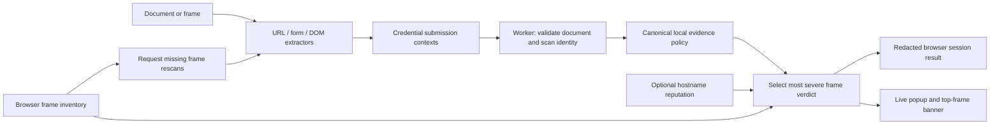

# PhishGuard 0.5.0 architecture

The extension uses a local, explainable evidence policy. Historical learned models
remain research artifacts and are not loaded by the default service worker.
The overall risk index is an evidence score, not a phishing probability or a
verified statement of website ownership.

## Extraction and privacy

`feature-schema.js` retains the 29 numeric research features at schema version
`0.2.0`; the current policy and runtime release are `0.5.0`. Form analysis also
supplies structured submission contexts and policy flags. Actual extractor and
policy source hashes distinguish changed behavior even when numeric feature names
remain stable. Older models cannot silently reuse the current extractor merely
because their feature names match.

The pinned offline Public Suffix List includes ICANN and PRIVATE rules. Browser
and Python use the same rule data, including exceptions and wildcards. Domains
such as different `github.io` tenants remain separate.

Input metadata includes type, name, autocomplete, associated labels, ARIA names
and placeholders. Typed values, password values and editable contents are never
read for classification. Email recovery instructions are not treated as password
entry merely because their prose contains the word password. Native inputs,
textareas and metadata-bearing `[role="textbox"]` controls are considered.
Sensitivity recognition includes passwords, OTPs, card metadata and other finite
credential vocabulary; unfamiliar control designs and languages can still be
missed.

Open shadow roots and assigned slots participate in composed-tree inspection.
Visibility checks account for closed details/dialogs, hidden/inert ancestors,
CSS visibility/opacity and supported browser rendering checks. Editable metadata
descendants are excluded, including labels or headings that contain an editor.
Closed shadow roots and image/canvas-only prompts are not inspected.

Brand detection considers deliberate title/hostname claims and short primary
login headings when sensitive fields are present. Arbitrary body mentions,
reviews, footer text and federated-provider phrases do not by themselves establish
ownership claims. A title saying "Sign in with a Google Account" is handled as a
provider mention. URL query mentions are ignored. Each claimed brand is checked
independently: an owned Google hostname cannot cancel a PayPal mismatch. Owner
mappings are finite identity references, never permission to bypass transport or
destination checks. They require periodic maintenance.

Static inline script patterns and iframe visibility remain weak observations.
No static token coincidence is described as proven credential theft. The
extension does not analyze external script bodies, intercept network requests or
prove where a JavaScript submit handler sends credentials.

## Evidence and verdicts

Each credential submission context is assessed separately. Destination and
transport evidence from unrelated forms or submit buttons cannot combine.
Submission overrides and externally associated controls remain attached to their
own form context. Related observations contribute their category maximum rather
than accumulating repeated versions of the same claim.

Identity mismatch with credentials contributes 45, cross-site submission 35,
an IP credential target 45, invalid target 35, HTTP transport 35 and HTTPS-to-HTTP
downgrade 45. A sensitive form's native GET submission path contributes 35
transport points, including the browser's default GET when the method is omitted
or invalid. JavaScript-only/non-native submission remains inconclusive; detection
does not assert that a handler actually executed. An inherited-origin document
with an unresolved native action reports unknown destination coverage rather
than inventing a same-site destination.

General address and DOM patterns have small bounded contributions. Password presence,
login words, hidden CSRF fields and short branded pages are not warning evidence.
Same-site HTTPS credential collection can therefore remain Low risk when the
page supplies no independently observable deception or unsafe transport evidence.
This is an observation limit, not proof that the submission is safe.

A narrowly scoped address-deception check can contribute 35 address points when
a short exact visible primary login heading matches a reviewed visual hostname
substitution or an embedded official domain, and that heading belongs to the
same sensitive credential context. Combined with the 45-point identity mismatch,
this catches certain same-origin HTTPS impersonation forms. Exactly one reviewed
ASCII/Cyrillic character substitution is recognized; arbitrary edit distance,
internationalized domains, shared hosting and title-only claims cannot activate
this check alone. PRIVATE suffix boundaries select the actual hosted tenant.
Article, navigation, footer, aside and comment exclusions follow the composed
tree through open shadow roots and slots. The finite brand/character coverage
does not solve generic or image-only same-origin credential harvesting.

Caution begins at 35. High risk requires credential context, two independent
primary groups (identity, destination, transport, or contextually verified address
deception), and the configured threshold
(default 65, adjustable 35-90). A single primary group alone cannot qualify for
High risk, and uncorroborated scores are capped at 64. The most severe context is
selected. Different frame scores are never added.

A configured reputation service's malicious verdict is explicit external evidence
and can produce High risk with a score of at least 90. A safe, benign or unknown
service response never suppresses the local verdict. A failed request supplies
no verdict. `SAFE` is the internal name for "no strong indicators"; it does not
verify website identity.

Reasons come from the exact winning evidence rather than being independently
recomputed from normalized vectors. Popup, banner and metadata use the canonical
outcome. `metadata.rule_score` retains the local rule score even when reputation
raises the overall score displayed as the risk index.

The popup displays browser-derived ASCII site origins, a separate embedded-frame
origin when relevant, practical next steps, settings access and a manual scan
request. The worker verifies the request's exact URL against browser inventory;
the popup confirms completion only after a newer document/scan identity arrives.
No extra website or model server is needed for this interface.

## Runtime identity, refresh and recovery

Content scripts are installed at `document_start` in all matching frames with
origin fallback enabled. Observation and interaction listeners are established
early; initial complete-document analysis runs at DOMContentLoaded or immediately
if the document is already ready. This reduces idle injection gaps without
claiming to synchronously block credential submission.

Each isolated content-script document has a random token and monotonically
increasing scan number. Browser-provided document/frame identifiers, current
frame inventory and navigation events bind results to the current document.
Delayed settings/reputation work, destroyed/replaced frames and out-of-order
scans are rejected. Full URLs are used in memory for exact identity and SPA
location matching; an origin match alone is not the freshness check.

Relevant DOM attributes, additions, removals and text changes trigger debounced
rescans, normally after 600 ms and at most two seconds after the first pending
change. Browser history events handle SPA routes without patching page JavaScript
from an isolated world. Back/forward cache restoration restarts observation and
rescans; tab loading-complete notifications request another scan as needed.

Visible documents also run a three-second render watch. It discovers newly
attached open shadow roots and compares rendered state for up to 512 controls,
covering stylesheet-only visibility changes that do not emit DOM mutations.
Full feature extraction still considers all controls. When the periodic watch is
truncated, `visibility_watch_truncated` is disclosed as an inspection limit;
there is no claim of complete periodic coverage on oversized pages. Stylesheet
and iframe load, details toggles, resize and visibility restoration request
additional scans. Capture-phase focus, pointer and native submit events request
immediate scans, limited to one interaction scan per 200 ms. These measures reduce
timing gaps; the asynchronous worker and page-owned JavaScript still prevent a
guarantee that every submission will be analyzed first.

Normal HTTP(S) frames are inspected independently. Inherited HTTP(S) origins for
`about:blank`, `about:srcdoc` and blob documents are supported when browser
injection is permitted. `document-context.js` keeps the actual document URL
separate from its effective security origin. The worker requires the supplied
context origin to equal browser-provided `MessageSender.origin`; page markup or
an HTML base URL cannot establish that origin. Opaque sandbox/data documents,
browser-protected pages and closed trees remain coverage gaps.

The worker compares inspected records with `webNavigation.getAllFrames` on scans
and popup reads. Missing inspectable frames receive targeted rescan requests,
with repeat requests for the same frame/document throttled for three seconds.
A cold worker reconstructs state from current content-script responses instead
of assuming a parent-only scan represents the entire tab. Opening the popup
wakes the worker and requests recovery when no current result exists.

The tab result reports `coverage.inventoryAvailable`, `uninspectedFrames`,
`pendingFrames`, `recovering`, `complete` and fixed `limitations` codes. Complete
means the available frame inventory has results and no reported inspection
limits; it is not a claim that opaque controls, all runtime data flows or website
identity have been verified. A Low risk result with known missing/pending
coverage is shown neutrally as "Incomplete inspection". While missing frames
are being recovered, the top-frame content script retains an existing High risk
banner instead of clearing it on a parent-only result.

Warnings use a top-frame banner and the extension popup. Banner repair restores
ordinary removed nodes, text and styles, and avoids replacing page-owned elements
with a colliding ID. The page still owns its DOM/CSS and can interfere with a
banner; the extension popup is the independent warning surface. Neither warning
surface blocks form submission.

## Optional hostname reputation

Reputation is off by default. A user-configured endpoint receives only the
effective document hostname, including inspected frames, as a `hostname` query
parameter. Requests omit credentials, reject redirects, use no HTTP cache and
time out after five seconds. Endpoints require HTTPS except localhost HTTP;
embedded username/password and fragments are rejected in options and the worker.
No page path/query, field value or page text is sent. The configured service also
sees ordinary connection metadata such as the client's IP address.

Same-endpoint/hostname requests share one in-flight lookup. Each worker allows
at most four concurrent requests and thirty new requests per minute per worker
lifetime. The in-memory rate counter restarts with the worker; the session
hostname cache still avoids fresh requests for unexpired available verdicts. A bounded
256-entry cache uses a SHA-256 endpoint digest plus hostname as its key. A
malicious/phishing verdict can be reused for ten minutes, safe/benign five minutes,
unknown thirty seconds, and errors fifteen seconds. Available verdicts are redacted to
hostname, endpoint digest, verdict and timestamps in browser session storage so
an ordinary worker restart does not discard a recent malicious verdict. Errors
remain in worker memory. A cache storage failure does not suppress local analysis.

Each frame reports `reputationStatus` (`disabled`, `pending`, `available`, `error`)
and a fixed failure code when relevant. Tab-level `reputationCoverage` counts each
status across inspected frames. The aggregate status prioritizes error, then
pending, then available, then disabled. A completed lookup on one frame cannot
hide another frame's failed check. The selected verdict can still be High risk
from a completed malicious lookup while another frame reports an error; popup
wording describes partial remote coverage without discarding that warning.

Configuration revisions abort pending requests and reject late completions.
Changing only the warning threshold retains same-service unexpired verdicts;
changing the reputation endpoint or enabled state clears the cache. Disabling
reputation also removes cached hostname verdicts. Cache entries can outlive a
closed tab. Expired verdicts are not reused; physical session records can remain
until the next cache write/clear or the browser session ends. Endpoint paths/query
secrets are saved only as part of explicit local configuration, not in session
cache output. A hash partitions cache entries; it is not a general secret vault.

## Session results and reviewed feedback

Persisted tab results omit document URL paths, queries and fragments, and tab-close
events remove them. Session storage is not exposed to content scripts. Legacy
persistent tab records are removed on startup. Settings and optional corrections
use local extension storage; successful saves and deletions are announced only
after completion, with callback `runtime.lastError` and Promise failures surfaced.

Saving a correction is an explicit user action. A strict whitelist retains only
top-page/evidence origins, evidence frame number, expected and observed outcomes,
score, timestamp, policy version and coarse coverage/reputation/category context.
At most 100 corrections remain locally. Full URLs, raw reasons, field metadata and
page text are excluded; older records are sanitized or discarded.

Options shows saved candidates and lets the user mark checked corrections for an
explicit JSON download. Only reviewed entries are exported, with declarations
that they are unverified candidates and automatic learning is disabled. Export
does not upload data. Corrections never change live predictions or create site
allowlists. Independent label/ownership review and fresh capture evidence are
required before a candidate can enter a benchmark or training collection. This
workflow is not a shortcut around the dataset review requirements.

## ML workflow and deployment boundary

See [the ML workflow](../ml/README.md) for implemented commands and acceptance
details. URL-only features remain separate from browser-captured DOM observations.
The workflow preserves final document URLs, groups redirect-connected sites and
duplicate content, quarantines conflicting labels and records dataset identity
manifests. CSV/JSONL round trips preserve weaker provenance classifications;
renaming a file or adding a nonempty source column cannot establish independence.

Browser captures bind the final snapshot's HTTP response to its CDP frame/loader
identity, rejecting a redirect's old 200 response as evidence for a final 404.
Current isolated-world numeric and structured policy features, source hashes and
reviewed labels are required for release DOM evidence. Static HTML reconstruction
remains a fixture/research fallback, not a rendered browser observation.

A compact exact predictor is fitted before independent FPR-budget calibration.
The exported ensemble is the evaluated ensemble; no silent first-N-tree
truncation is allowed. Float32 input semantics match sklearn tree prediction.
Schema, extractor, PSL and predictor identities are recorded. Frozen future data
must be separate from training/selection by URL, domain/content, source and time.

Predeclared release gates require both page and conservative independent-group
FPR upper 95% confidence bounds within a budget no greater than 1%, and recall
lower 95% bounds of at least 80%. They also require independent-group sample
counts, reviewed sources and legitimate login/SSO/banking/education/payment/non-login
coverage. An all-Low-risk classifier fails the recall gate even with zero observed
false positives. These are acceptance targets, not achieved measurements.

The actual shipped JavaScript local policy can be evaluated separately against
reviewed captured contexts; frame aggregation, optional reputation, lifecycle and
warning delivery still need integration/browser tests. Research reports and a
model's own "validated" string cannot approve deployment. The release remains
rules-only until an explicitly integrated compatible model, independent calibration
and frozen held-out evaluation satisfy the full release process.

Offline fixture tests validate implementation behavior. No representative
captured benchmark is present in this checkout, so they do not establish
real-world false-positive rate, recall or resistance to previously unseen attacks.
